<!--
  Hand-drawn README. Every image here is an SVG generated by scripts/:
    python scripts/build_assets.py   → header, sections, cards, timeline, toolkit…
    python scripts/activity.py       → activity panel (runs daily via GitHub Actions)
  Each asset ships in assets/dark and assets/light; <picture> picks the one
  that matches the viewer's GitHub theme.
-->

<a href="https://kartik-rathi.site"><picture><source media="(prefers-color-scheme: dark)" srcset="assets/dark/header.svg"></picture></a>

 

  <a href="https://linkedin.com/in/devkartikrathi"><picture><source media="(prefers-color-scheme: dark)" srcset="assets/dark/btn-linkedin.svg"></picture></a>
  <a href="https://kartik-rathi.site"><picture><source media="(prefers-color-scheme: dark)" srcset="assets/dark/btn-portfolio.svg"></picture></a>
  <a href="mailto:devkartikrathi@gmail.com"><picture><source media="(prefers-color-scheme: dark)" srcset="assets/dark/btn-email.svg"></picture></a>
  <a href="https://x.com/devkartikrathi"><picture><source media="(prefers-color-scheme: dark)" srcset="assets/dark/btn-x.svg"></picture></a>
  <a href="https://cal.com/devkartikrathi/30min"><picture><source media="(prefers-color-scheme: dark)" srcset="assets/dark/btn-call.svg"></picture></a>

 

<picture><source media="(prefers-color-scheme: dark)" srcset="assets/dark/section-01.svg"></picture>

I build LLM systems that hold up in production: retrieval that cites its sources, agents that finish the job, and pipelines with latency and error budgets that someone actually watches.

I'm a **Software Engineer at [Global Payments](https://globalpayments.com)**. Before that I shipped RAG and ML pipelines on GCP at Arcap, document intelligence at NeedCFO, and Sanskrit-to-English translation research at IIT Mandi. Ask me about RAG architecture, evaluation, FastAPI, agent orchestration, or system design.

<picture><source media="(prefers-color-scheme: dark)" srcset="assets/dark/metrics.svg"></picture>

> [!NOTE]
> **Now:** automating team operations at Global Payments, turning tracking, reporting and comms into reusable workflows. On the side I'm shipping small, opinionated products like [VimLearn](https://github.com/devkartikrathi/vimlearn), [Chronos](https://github.com/devkartikrathi/time-tracker) and [Reimagining Delhi](https://github.com/devkartikrathi/DelhiGov).

 

<picture><source media="(prefers-color-scheme: dark)" srcset="assets/dark/section-02.svg"></picture>

<picture><source media="(prefers-color-scheme: dark)" srcset="assets/dark/timeline.svg"></picture>

 

<picture><source media="(prefers-color-scheme: dark)" srcset="assets/dark/section-03.svg"></picture>

  <a href="https://github.com/devkartikrathi/vimlearn"><picture><source media="(prefers-color-scheme: dark)" srcset="assets/dark/card-vimlearn.svg"></picture></a>
  <a href="https://github.com/devkartikrathi/DelhiGov"><picture><source media="(prefers-color-scheme: dark)" srcset="assets/dark/card-delhi.svg"></picture></a>

  <a href="https://github.com/devkartikrathi/time-tracker"><picture><source media="(prefers-color-scheme: dark)" srcset="assets/dark/card-chronos.svg"></picture></a>
  <a href="https://github.com/devkartikrathi/pathgenie"><picture><source media="(prefers-color-scheme: dark)" srcset="assets/dark/card-pathgenie.svg"></picture></a>

  <a href="https://github.com/devkartikrathi/code-assist"><picture><source media="(prefers-color-scheme: dark)" srcset="assets/dark/card-codeassist.svg"></picture></a>
  <a href="https://github.com/devkartikrathi/finsight"><picture><source media="(prefers-color-scheme: dark)" srcset="assets/dark/card-finsight.svg"></picture></a>

  <a href="https://statly.kartik-rathi.site"><picture><source media="(prefers-color-scheme: dark)" srcset="assets/dark/card-statly.svg"></picture></a>
  <a href="https://github.com/devkartikrathi/ChatGita"><picture><source media="(prefers-color-scheme: dark)" srcset="assets/dark/card-chatgita.svg"></picture></a>

<b>Links, live demos & the archive</b>

 

| Project | What it is | Code | Live |
|:--|:--|:--:|:--:|
| **VimLearn** | 52-lesson Vim course in a hand-built modal editor | [repo](https://github.com/devkartikrathi/vimlearn) | — |
| **Reimagining Delhi** | Bilingual civic redesign on a hairline design system | [repo](https://github.com/devkartikrathi/DelhiGov) | — |
| **Chronos** | 24-hour time tracker with a deterministic insight engine | [repo](https://github.com/devkartikrathi/time-tracker) | — |
| **PathGenie** | Multi-agent career mentor with persistent memory | [repo](https://github.com/devkartikrathi/pathgenie) | [demo](https://pathgenie.kartik-rathi.site) |
| **Code Assist** | Browser IDE on WebContainers, Claude-powered edits | [repo](https://github.com/devkartikrathi/code-assist) | [demo](https://code-assist.kartik-rathi.site) |
| **FinSight One** | Hybrid-search RAG with page-level citations | [repo](https://github.com/devkartikrathi/finsight) | — |
| **Statly** | Trade analytics SaaS for Indian retail traders | private | [demo](https://statly.kartik-rathi.site) |
| **ChatGita** | Semantic verse retrieval over the Bhagavad Gita | [repo](https://github.com/devkartikrathi/ChatGita) | — |
| Legacy | Collaborative family-tree builder on React Flow | [repo](https://github.com/devkartikrathi/family-tree) | — |
| Presentation Summarization | Condense PPT decks while keeping the core ideas | [repo](https://github.com/devkartikrathi/presentation-summarization) | — |

 

<picture><source media="(prefers-color-scheme: dark)" srcset="assets/dark/section-04.svg"></picture>

<picture><source media="(prefers-color-scheme: dark)" srcset="assets/dark/pipeline.svg"></picture>

Retrieval is hybrid by default, answers carry citations or don't ship, and every change is gated on an eval run (faithfulness, answer relevance, latency) rather than vibes.

  

<picture><source media="(prefers-color-scheme: dark)" srcset="assets/dark/section-05.svg"></picture>

<picture><source media="(prefers-color-scheme: dark)" srcset="assets/dark/toolkit.svg"></picture>

 

<picture><source media="(prefers-color-scheme: dark)" srcset="assets/dark/section-06.svg"></picture>

<a href="https://github.com/devkartikrathi?tab=overview"><picture><source media="(prefers-color-scheme: dark)" srcset="assets/dark/activity.svg"></picture></a>

 

<picture><source media="(prefers-color-scheme: dark)" srcset="assets/dark/section-07.svg"></picture>

<picture><source media="(prefers-color-scheme: dark)" srcset="assets/dark/statement.svg"></picture>

  <a href="https://linkedin.com/in/devkartikrathi"><picture><source media="(prefers-color-scheme: dark)" srcset="assets/dark/btn-linkedin.svg"></picture></a>
  <a href="https://kartik-rathi.site"><picture><source media="(prefers-color-scheme: dark)" srcset="assets/dark/btn-portfolio.svg"></picture></a>
  <a href="mailto:devkartikrathi@gmail.com"><picture><source media="(prefers-color-scheme: dark)" srcset="assets/dark/btn-email.svg"></picture></a>
  <a href="https://x.com/devkartikrathi"><picture><source media="(prefers-color-scheme: dark)" srcset="assets/dark/btn-x.svg"></picture></a>
  <a href="https://cal.com/devkartikrathi/30min"><picture><source media="(prefers-color-scheme: dark)" srcset="assets/dark/btn-call.svg"></picture></a>

<picture><source media="(prefers-color-scheme: dark)" srcset="assets/dark/footer.svg"></picture>
